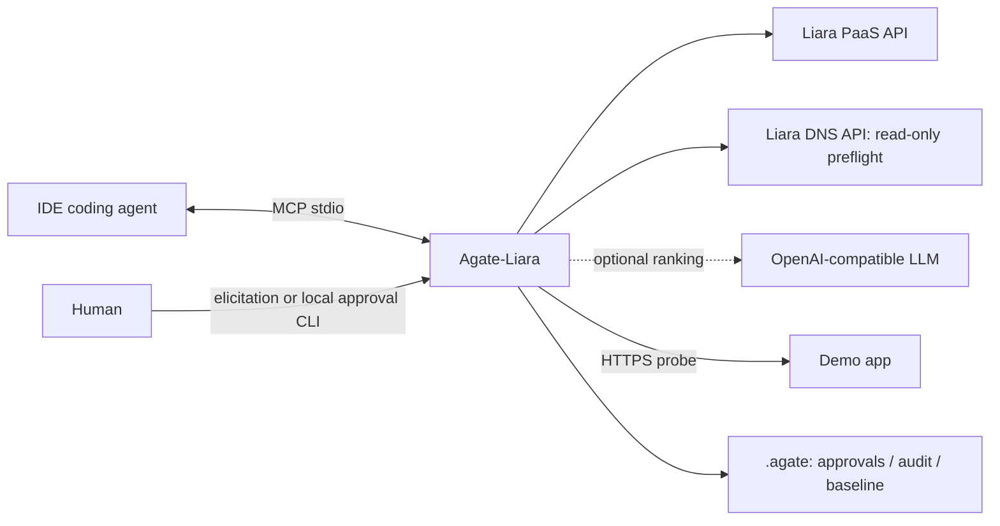
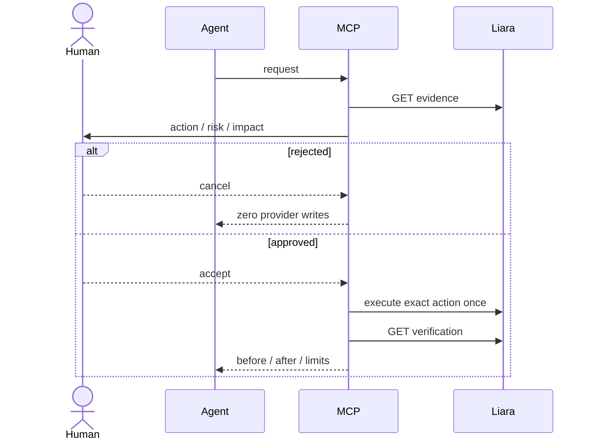

# Agate-Liara · Agate Co.

دستیار DevOps/SRE فارسی برای چالش لیارا در هکاتون Starcoach Agentic AI؛ یک سرور TypeScript MCP با انتقال stdio، بدون دیتابیس، LangGraph یا کنسول وب مدیریتی. سایت دمو یک اپ مستقل و عمداً قابل خراب‌کردن است.

**وضعیت:** preflight زنده ۴/۴ موفق است. اپ `agate-liara` با تأیید صریح و یک POST ساخته شد: `small-g2/basic` + شبکهٔ `6ada1e64b3b5ca83e1ee0ce1`؛ GET آن را `ACTIVE` و `isDeployed:false` نشان می‌دهد. هنوز هیچ آپلود، release یا انتشار انجام نشده و دامنه سرویس نمی‌کند. آخرین وضعیت: [PROGRESS.md](PROGRESS.md)، [آزمون‌ها](docs/TEST_EVIDENCE.md) و [محدودیت‌ها](docs/LIMITATIONS.md). مخزن خصوصی است و push انجام نشده است.

## اجرای سریع

نیازمندی: Node ≥20 و npm. دستورات را در ریشهٔ همین مخزن اجرا کنید:

```powershell
npm ci
# اگر .env وجود ندارد:
Copy-Item .env.example .env
# توکن و تنظیمات اختیاری را فقط داخل .env وارد کنید.
npm run build
npm test
npm run demo:test
npm run smoke
# برای بررسی مستقل از شبکه:
npm run smoke -- --offline
npm run preflight
```

از بازنویسی `.env` موجود خودداری کنید. نبودن توکن مانع بالا آمدن MCP نیست؛ ابزارهای لیارا پیام فارسی راهنما می‌دهند. خروجی پروتکل روی stdout و پیام راه‌اندازی روی stderr است.

## معماری



## تنظیمات

| متغیر | کاربرد / پیش‌فرض |
|---|---|
| `LIARA_API_TOKEN` | توکن API لیارا؛ برای عملیات واقعی الزامی |
| `LIARA_TEAM_ID` | اختیاری؛ `teamID` روی همهٔ درخواست‌های API |
| `LIARA_API_BASE` | `https://api.iran.liara.ir`؛ GET در خطای گذرا یک retry به `https://api.liara.ir` |
| `LIARA_DNS_BASE` | `https://dns-service.iran.liara.ir`؛ fallback دامنهٔ بدون iran |
| `AGATE_ALLOWED_APPS` | `agate-liara`؛ فهرست comma-separated برای عملیات نوشتنی |
| `LLM_BASE_URL` | URL سازگار با OpenAI تا `/v1`، بدون `/chat/completions` |
| `LLM_API_KEY`, `LLM_MODEL` | هر سه مقدار لازم‌اند؛ در غیر این صورت rules-only |
| `ADMIN_KEY` | کلید پنل آزمایش سایت دمو؛ بدون آن پنل بسته است |
| `BUG_MODE` | حالت اولیهٔ سایت دمو: `off`, `leak`, `slow`, `error500` |

اولویت: محیط کلاینت > `.env` در cwd > `.env` در ریشهٔ پکیج. سرور را با cwd همین مخزن اجرا کنید تا approval CLI و preflight از state مشترک استفاده کنند. `.env`، `.agate`، `node_modules` و `dist` gitignored هستند.

## ابزارها

| سطح | ابزارها |
|---|---|
| A: خواندنی | `ping`, `liara_status`, `liara_list_apps`, `liara_logs`, `liara_metrics`, `liara_events`, `liara_plans`, `liara_releases`, `http_probe`, `audit_tail`, `liara_plan_price`, `liara_release_status` |
| B: تأیید لازم | `liara_create_app`, `liara_deploy`, `liara_set_env`, `liara_restart`, `liara_scale`, `liara_resize`, `liara_add_domain`, `liara_enable_ssl`, `propose_action`, `execute_action` |
| ترکیبی | `deploy_project`, `diagnose`, `apply_fix`, `verify_fix`, `connect_domain`, `watch_after_deploy` |
| C: راهنما | `guide_domain_registration`, `guide_rollback`, `guide_github_deploy` |

`http_probe(target, path="/health", count=3)` فقط HTTPS دامنه‌های متصل به اپ‌های مجاز را می‌پذیرد و redirect را دنبال نمی‌کند. `diagnose` علاوه بر متریک و لاگ، صفحهٔ `/` را می‌سنجد تا سلامت `/health` خطای صفحهٔ اصلی را پنهان نکند. `verify_fix` همان مسیر baseline را بررسی می‌کند؛ نبودن لاگ یا baseline معتبر را موفقیت گزارش نمی‌کند.

## تأیید و اجرای امن

قبل از اولین write، `npm run preflight` باید با همان توکن/تیم موفق شود؛ رسید محلی تا ۲۴ ساعت معتبر است. هر اختلاف API را در [LIARA_API.md](docs/LIARA_API.md) ثبت و اصلاح کنید. خطای preflight مانع mutation است؛ retry خودکار برای write نداریم.



در کلاینت سازگار، پنجرهٔ elicitation باز می‌شود. بدون elicitation، ابزار فقط `approvalId` می‌دهد. **کاربر** در ترمینال اجرا می‌کند:

```powershell
npm run approve -- <approvalId>
```

خلاصه و هش را بررسی و `yes` وارد کنید؛ پاسخ دیگر لغو است. سپس ایجنت `execute_action(approvalId)` را صدا می‌زند. ایجنت نباید خودکار به جای انسان CLI تأیید را اجرا کند. شناسه به پارامترها مقید، ۱۰دقیقه‌ای و تک‌مصرف است. اگر نتیجهٔ write مبهم شد، قبل از پیشنهاد مجدد وضعیت را بخوانید. state محلی برای یک فرایند MCP طراحی شده است، نه چند executor همزمان.

## اتصال MCP در IDE

نمونه‌های قابل کپی در [examples/](examples/) هستند؛ مسیرها را با مسیر مطلق مخزن خود جایگزین کنید. هیچ فایل نمونه‌ای کلید واقعی ندارد. فرمت‌ها از اسناد رسمی در ۲۰۲۶-۱۰-۲۲ بررسی شدند؛ اتصال واقعی هر IDE جداگانه هنوز NOT_RUN است.

### VS Code: `.vscode/mcp.json`
```json
{"servers":{"agate-liara":{"type":"stdio","command":"node","args":["${workspaceFolder}/dist/index.js"],"cwd":"${workspaceFolder}"}}}
```
این قالب VS Code با `servers` است؛ اسناد جدید Copilot برای قالب portable، `.mcp.json` با `mcpServers` هم دارند. این دو را مخلوط نکنید.

### Cursor: `.cursor/mcp.json`
```json
{"mcpServers":{"agate-liara":{"type":"stdio","command":"node","args":["${workspaceFolder}/dist/index.js"],"envFile":"${workspaceFolder}/.env"}}}
```

### OpenCode V2: `opencode.json`
```json
{"$schema":"https://opencode.ai/config.json","mcp":{"servers":{"agate-liara":{"type":"local","command":["node","dist/index.js"],"cwd":".","environment":{"AGATE_ALLOWED_APPS":"agate-liara"}}}}}
```
تفاوت با پرامپت اولیه: در V2 نام سرورها زیر `mcp.servers` است، نه مستقیماً `mcp`.

### Codex: `~/.codex/config.toml`
```toml
[mcp_servers.agate-liara]
command = "node"
args = ["D:/Hackaton/Liara/Hackaton-Liara/dist/index.js"]
cwd = "D:/Hackaton/Liara/Hackaton-Liara"
tool_timeout_sec = 900
```

پس از اتصال، `ping` را اجرا و فهرست ابزارها را مشاهده کنید؛ سپس `liara_list_apps`. کلید را در چت ننویسید. مهلت کلاینت برای deploy باید حدود ۱۵ دقیقه باشد.

منابع قالب‌ها: [VS Code](https://code.visualstudio.com/docs/agent-customization/mcp-servers)، [Cursor](https://cursor.com/docs/context/mcp)، [Codex](https://developers.openai.com/codex/extend/mcp)، [OpenCode V2](https://opencode.ai/v2/docs/mcp-servers).

## سایت دمو

```powershell
node --env-file=.env demo-site/server.mjs
```

صفحهٔ اصلی: `http://localhost:3000/`؛ پنل آزمایش: `/__agate-admin?key=<ADMIN_KEY>`؛ مسیر سلامت: `/health`.

سه حالت خراب‌سازی: افزایش Buffer حدود ۵MB/ثانیه، تأخیر ۲–۴ ثانیه و خطای واقعی TypeError. Buffer بیرون heap است؛ `extMB` و `rssMB` در health هم گزارش می‌شوند. این اپ فقط برای محیط دورریختنی است؛ حالت leak را بی‌مراقبت رها نکنید. Torob و Wallex فقط محتوای ایستا هستند.

برای انتشار، ایجنت را به `deploy_project(path="./demo-site", app="agate-liara")` هدایت کنید؛ **ریشهٔ MCP را به‌عنوان وب‌سایت دیپلوی نکنید**. `ADMIN_KEY` را بعداً با `liara_set_env` و تأیید انسانی روی اپ تنظیم کنید؛ بسته‌بندی `.env` را ارسال نمی‌کند.

## محدودیت‌ها

**ناسازگاری زندهٔ بستهٔ امکانات:** درخواست با `bundlePlanID=default` رد شد:
`"bundlePlanID" must be one of [free, basic, standard, pro]`.
مقادیر مجاز طبق اعتبارسنجی POST فقط `free`، `basic`، `standard` و `pro` هستند؛ حضور در enum تضمین دسترسی یا پذیرش برای هر پلن نیست. GET همچنان برای نسل قبل `g1.default` نشان می‌دهد و تعرفهٔ `basic`/`standard` برای `ir-small` را اعلام نمی‌کند. هزینهٔ منابع این پلن حدود ۹۵۰٬۰۰۰ تومان/ماه است؛ هزینهٔ کل با بستهٔ جایگزین هنوز معلوم نیست. هر تغییر بسته و تلاش مجدد نیازمند تأیید تازه است؛ fallback خودکار نداریم. وضعیت تلاش‌ها در `PROGRESS.md` ثبت می‌شود.

**نتیجهٔ نهایی ساخت:** ترکیب دقیق `small-g2/basic` همراه با `network=6ada1e64b3b5ca83e1ee0ce1` با یک POST پذیرفته شد و `projectID=6ada2dd838253e6cdf2b836e` برگشت؛ GET نیز اپ را `ACTIVE` با همان پلن/بسته/شبکه تأیید کرد. دو تلاش قبلی g2/ir-small بدون همین شبکه بودند. این موفقیت به معنی تأیید deploy یا سلامت سرویس نیست: `isDeployed:false` است و هیچ release/آپلودی انجام نشده.

تلاش صریحاً تأییدشده با `ir-small/basic` نیز با `g1_plan_unavailable` رد شد و GET وجود هیچ اپی را نشان نداد. بنابراین معتبر بودن شناسهٔ بسته به‌تنهایی کافی نیست؛ محدودیت نسل پلن/تیم هم ممکن است مانع ساخت شود.

**قاعدهٔ انتخاب تثبیت‌شده:** deploy/create فقط `plans.projects[planID]` با `available===true` و `region==="iran"` را با بستهٔ فعال زیر `plans.projectBundlePlans[همان planID]` جفت می‌کنند؛ `g1.default` به پلن دیگری نسبت داده نمی‌شود. قیمت کل منابع+بسته از API می‌آید؛ نبودن قیمت یعنی حذف گزینه، نه حدس. قبل از تأیید و مجدداً پیش از POST کاتالوگ خوانده می‌شود؛ جفت حذف‌شده یا قیمت تغییرکرده نیازمند پیشنهاد و تأیید تازه است. snapshot بدون توکن: `docs/PLAN_CATALOG_LIVE.json`. حتی `available=true` هم تضمین پذیرش ساخت توسط سرویس نیست.

| محدودیت API / اجرا | جایگزین |
|---|---|
| rollback endpoint ندارد | بررسی release و redeploy سورس قبلی با تأیید |
| log streaming ندارد | polling |
| endpoint مستقل plans ندارد | `GET /v1/me` |
| health-check API ندارد | HTTP probe مستقل |
| ثبت دامنه ندارد | IRNIC دستی |
| اتصال مستقیم GitHub ندارد | workflow راهنمای CLI |
| DNS zone/record mutation هنوز پیاده نشده | رکوردهای پاسخ لیارا را دستی تنظیم کنید |

سناریوی ارائه: [DEMO_SCRIPT.md](DEMO_SCRIPT.md). هیچ تست mock یا تصویر نمایشی اثبات دیپلوی زنده نیست.
