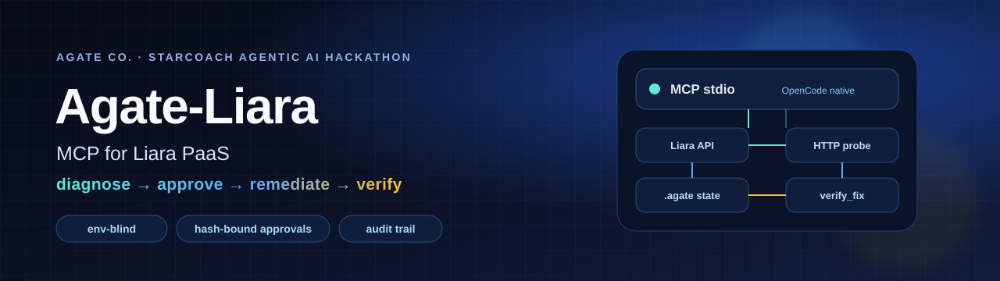
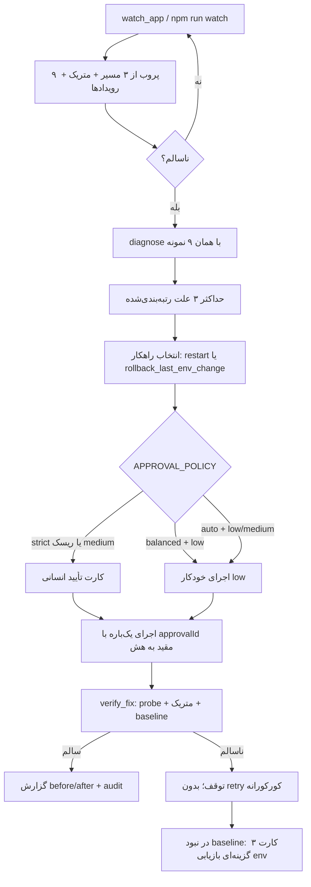
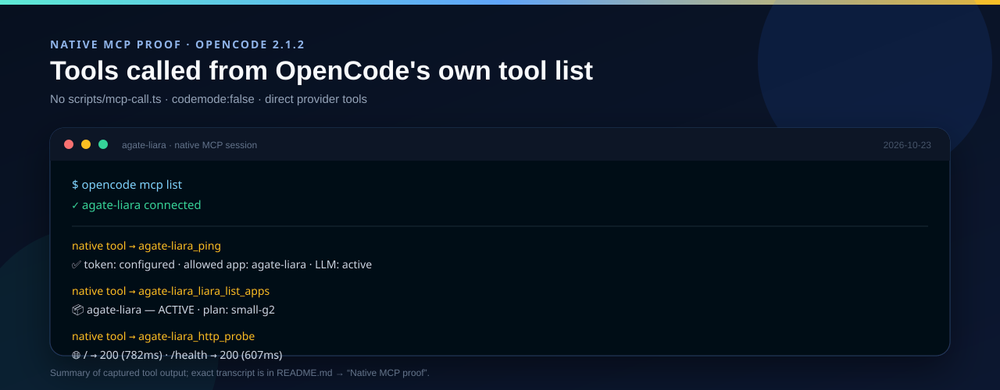
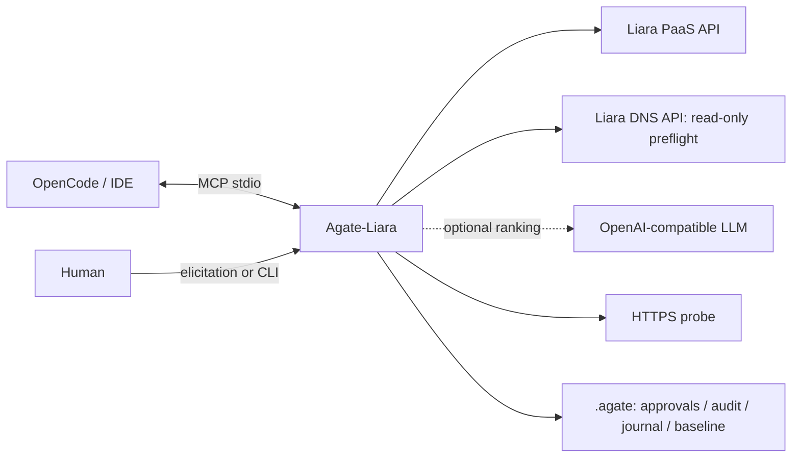
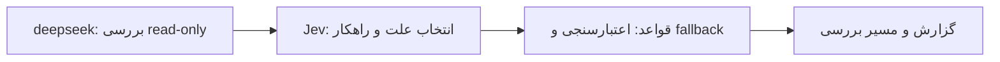

<p align="center">
  
</p>

<h1 align="center">Agate-Liara</h1>

<p align="center">
  دستیار DevOps/SRE فارسی برای لیارا — تشخیص با شواهد، سیاست تأیید، رفع قابل‌بازگشت و verify مستقل.
</p>

<p align="center">
  
  
  
  
  
  
  
</p>

## Current Status

مرجع وضعیت همین بخش است. مشاهدهٔ ۲۰۲۶-۱۰-۲۳:

| مورد | آخرین مشاهده | یادداشت |
|---|---|---|
| اپ `agate-liara` | `ACTIVE` · پلن `small-g2` · scale `1` | شبکهٔ `6ada1e64b3b5ca83e1ee0ce1`؛ دامنهٔ پیش‌فرض `agate-liara.liara.run` |
| Release این دیپلوی | `6adb239b2c3f63ca360563ab` · `READY` | یک انتشار تأییدشده از `./demo-site`؛ فهرست ده‌تایی قبلی دوباره خوانده نشد |
| `/` و `/health` | هر دو HTTP 200 | بعد از همین دیپلوی. پروب سلامت ابزار: یک نمونه ۷۹۶ms. `GET /health` مستقل: `status=ok` و `bugMode=off`. SLA نیست |
| Native MCP | OpenCode 2.1.2 متصل | `codemode:false`؛ فراخوانی مستقیم ابزارها اثبات شد. Cursor / VS Code / Codex هنوز `NOT_RUN` |
| Live rollback | **NOT_RUN** | برای ضبط ویدیو موکول شده؛ در آن بررسی mutation انجام نشد |
| تأیید | `APPROVAL_POLICY=strict` پیش‌فرض | همهٔ نوشتن‌ها تأیید می‌خواهند. `balanced` فقط low-risk را خودکار می‌کند. high-risk در هر سیاست تأیید می‌خواهد |
| `liara_status` | نام کلیدهای env | مقدارها ماسک می‌شوند. `diagnose` و LLM این فهرست را نمی‌بینند |
| بررسی diagnose | `INVESTIGATE_MODE` | پیش‌فرض `agentic` وقتی LLM تنظیم است، وگرنه `fixed`. مسیر fixed همان تشخیص قبلی است |
| LangGraph | خارج از محدوده | کار آینده است؛ issue بازی برای آن باز نیست |

## معرفی کوتاه

**Agate-Liara** یک سرور MCP با انتقال `stdio` است که یک ایجنت کدنویس را به لیارا وصل می‌کند: وضعیت اپ، لاگ، متریک، رویداد، release، دامنه و پروب HTTP را می‌خواند؛ رخداد را با شواهد محدود به پنجرهٔ ۱۰ دقیقه‌ای تشخیص می‌دهد؛ و اقدام درمانیِ قابل‌بازگشت را فقط طبق `APPROVAL_POLICY` اجرا می‌کند. سرور بدون دیتابیس یا کنسول مدیریتی است. LangGraph خارج از محدودهٔ این ارائه و کار آینده است. state حساس محلی است و وارد ورودی LLM نمی‌شود.

سه ویژگی که آن را از «چت‌بات DevOps» جدا می‌کند:

- **تشخیص env-blind:** مقدار env، فهرست کلیدهای env و بدنهٔ `/health` وارد تشخیص یا پرامپت LLM نمی‌شوند. `liara_status` جداگانه نام کلیدها را نشان می‌دهد و مقدارها را ماسک می‌کند.
- **تأیید مقید به هش:** هر نوشتن از یک نقطهٔ تصمیم‌گیری (`decideApproval`) عبور می‌کند؛ approval به پارامترهای دقیق، ۱۰ دقیقه و یک‌بار مصرف مقید است.
- **verify قبل از ادعای موفقیت:** بعد از اقدام، پروب و متریک دوباره خوانده می‌شوند؛ نبود شاهد، موفقیت حساب نمی‌شود.

## نتایج واقعی تست‌ها

آخرین اجرای کامل: **۲۰۲۶-۱۰-۲۳**. ستون «حوزه» مشخص می‌کند شاهد، تست قطعی/unit است یا خواندن واقعی و read-only. هیچ مورد `NOT_RUN` را PASS حساب نکرده‌ایم.

| سناریو | نتیجه | شاهد و محدوده |
|---|---|---|
| **leak** | **PASS** | `npm run demo:test` → حالت leak واقعاً حافظهٔ نگه‌داشته‌شده را بالا می‌برد؛ `npm test` → «تشخیص نشت حافظه با سری صعودی و لاگ heap» |
| **slow** | **PASS** | `npm run demo:test` → حالت slow پاسخ صفحهٔ اصلی را حدود ۳.۷ ثانیه تأخیر می‌دهد؛ `npm test` → «تشخیص کندی پاسخ وقتی CPU نرمال است» |
| **blind** | **PASS (unit)** | `BUG_MODE` و رازهای رایج لاگ از پرامپت LLM حذف یا ماسک می‌شوند؛ `diagnose` مقدار env، فهرست کلیدها و بدنهٔ `/health` را وارد تشخیص نمی‌کند. `liara_status` نام کلیدها را جداگانه نشان می‌دهد |
| **watch** | **PASS (unit) + live read-only** | ۹ نمونه از ۳ مسیر؛ ۵xx/timeout/قطع اتصال، outage، خطای تکیِ گذرا، آستانهٔ p50 ۱۵۰۰ms، cooldown و snapshot سالم env تست شده‌اند؛ اجرای تاریخی `npm run watch -- --once` روی اپ واقعی healthy و بدون incident بود |
| **baseline rollback** | **PASS (unit)** | baseline سالم منبع سوم rollback است؛ diff فقط کلیدهای تغییرکرده را برمی‌گرداند؛ فایل در سیستم‌های پشتیبان‌شده با mode `0600` و بدون ارسال مقدار به LLM ذخیره می‌شود؛ بدون baseline کارت ۳ گزینه‌ای باز می‌شود |
| **live env rollback** | **NOT_RUN** | عمداً به ضبط ویدیو موکول شد؛ `APPROVAL_POLICY=strict` و هیچ mutationای انجام نشد |

### Quality gate

| بررسی | نتیجه | شاهد |
|---|---|---|
| `npm run typecheck` | **PASS** | `tsc -p tsconfig.json --noEmit` |
| `npm test` | **PASS — 123/123** | 0 failed · شامل allowlist، لایهٔ Jev و fallback، سقف اطمینان، مهلت حلقه و توقف watch |
| `npm run build` | **PASS** | `dist` بازسازی شد |
| `npm run smoke -- --offline` | **PASS** | stdio handshake واقعی، کشف **۳۳ ابزار**، ping |
| `npm run smoke` | **PASS** | live list + HTTP probe، فقط read-only |
| `npm run demo:test` | **PASS — 8/8** | health، slow، error500، leak، POST ادمین، رد query string |
| `npm run secret-scan` | **PASS** | **۸۸ فایل** قابل commit؛ کلید تنظیم‌شده/private-key marker یافت نشد (detector عمومی نیست) |
| `node dist/index.js --help` | **PASS** | command/args/cwd، متغیرها و خلاصهٔ اقدام قابل‌بازگشت |
| `git diff --check` | **PASS** | فقط هشدارهای line-ending ویندوز |

## چرا قابل اعتماد است؟

### ۱) تشخیص env-blind است

`diagnose` هیچ **مقدار env** و هیچ **فهرست کلید env** را از API نمی‌خواند. `liara_status` نام کلیدها را در خروجی خودش نشان می‌دهد و مقدارها را ماسک می‌کند؛ آن فهرست به diagnose یا LLM داده نمی‌شود. ورودی تشخیص فقط این‌هاست:

- لاگ‌ها و رویدادهای پنجرهٔ ۱۰ دقیقه‌ای حول `incidentAt`
- متریک CPU/حافظه (خام و بدون حدس واحد)
- status/latency مسیر `/` و `/health` — بدنهٔ `/health` parse نمی‌شود
- متادیتای audit/release برای «آیا تغییر env دقیقی وجود دارد؟» — فقط وجود/زمان، نه مقدار یا کلید

پرامپت LLM از همین ورودی ساخته می‌شود و `stripBugMode` هر اشارهٔ مستقیم به `BUG_MODE`/`bugMode` را حذف می‌کند. اگر شاهد کافی نباشد، پاسخ `inconclusive` است و LLM بی‌دلیل صدا زده نمی‌شود.

### ۲) سیاست تأیید یک نقطهٔ واحد دارد

تنها تابع تصمیم‌گیری [`decideApproval`](src/approval.ts) است. هر اقدام یک `riskLevel` از `low` / `medium` / `high` دارد:

| سیاست | رفتار |
|---|---|
| `strict` (پیش‌فرض) | **همهٔ** اقدام‌های نوشتنی تأیید انسانی می‌خواهند |
| `balanced` | فقط `low` خودکار است (`restart`، SSL و خواندن‌ها). `rollback_last_env_change` اکنون **`medium`** است و تأیید می‌خواهد؛ `liara_set_env`، deploy و resize هم تأیید می‌خواهند |
| `auto` | `low`/`medium` خودکار؛ `high` همچنان تأیید می‌خواهد |

اقدام‌های هزینه‌دار/پرخطر — ساخت اپ/شبکه، resize، scale و خاموش‌کردن سرویس — در **همهٔ** سیاست‌ها `high` هستند و همیشه تأیید می‌خواهند. approval به هش پارامترها مقید است، ۱۰ دقیقه اعتبار دارد، یک‌بار مصرف می‌شود و بعد از تغییر پارامترها باطل می‌شود. **هیچ fallback خودکار به restart وجود ندارد**: اگر baseline/journal برای rollback دقیق کافی نباشد، به‌جای تغییر کورکورانه، کارت ۳ گزینه‌ای بازیابی env نمایش داده می‌شود.

### ۳) Audit و state محلی قابل ردیابی‌اند

- هر تصمیم در `.agate/audit.jsonl` ثبت می‌شود: `pending`، `approved`، `auto:balanced` یا `not-required`.
- `.agate/env-history-<app>.json` فقط تغییرهای env انجام‌شده از همین MCP را با before/after واقعی نگه می‌دارد.
- `.agate/env-baseline-<app>.json` snapshot سالم env است؛ فقط وقتی پروب سالم است ثبت می‌شود.
- این فایل‌ها gitignored هستند، در سیستم‌هایی که پشتیبانی می‌شود با mode `0600` نوشته می‌شوند، در ورودی LLM قرار نمی‌گیرند و خروجی ابزارها فقط مقدارهای ماسک‌شده را نشان می‌دهد.
- `.env`، `.agate`، `node_modules` و `dist` هرگز commit نمی‌شوند.

## چرخهٔ تشخیص تا رفع



## اتصال Native MCP در OpenCode

فایل [`opencode.json`](opencode.json) در ریشهٔ مخزن، سرور را به‌صورت local و با `codemode:false` معرفی می‌کند. این یعنی ابزارها به‌جای wrapper کد، روی **لیست ابزارهای بومی provider** قرار می‌گیرند:

```json
{
  "$schema": "https://opencode.ai/config.json",
  "mcp": {
    "servers": {
      "agate-liara": {
        "type": "local",
        "command": ["node", "dist/index.js"],
        "cwd": ".",
        "environment": {
          "AGATE_ALLOWED_APPS": "agate-liara",
          "APPROVAL_POLICY": "strict"
        },
        "codemode": false
      }
    }
  }
}
```

پس از `npm run build` و `opencode reload`:

```text
$ opencode mcp list
✓ agate-liara  connected
```

> **نکتهٔ محیطی:** `opencode mcp list` وضعیت سرویس پس‌زمینهٔ workspace فعال را نشان می‌دهد. اگر OpenCode را از ریشهٔ مخزن اجرا می‌کنید، `opencode debug config` باید `opencode.json` همین مخزن را در فهرست sourceها نشان دهد؛ در این پروژه همین‌طور بود و اتصال native در session فعال با `codemode:false` تأیید شد.

### اثبات فراخوانی از ابزارهای خود OpenCode

| فراخوانی | نتیجهٔ مشاهده‌شده |
|---|---|
| `agate-liara_ping` | سرور فعال؛ توکن تنظیم شده؛ اپ مجاز `agate-liara`؛ LLM فعال |
| `agate-liara_liara_list_apps` | `agate-liara — ACTIVE · small-g2` |
| `agate-liara_liara_status` | `ACTIVE` · `small-g2` · scale `1` · ۴ کلید env |
| `agate-liara_liara_releases` | ۱۰ release آخر `READY` |
| `agate-liara_http_probe("/")` | HTTP 200 · 782ms |
| `agate-liara_http_probe("/health")` | HTTP 200 · 607ms |

نمونهٔ خروجی واقعی:

```text
✅ سرور Agate-Liara فعال است.
🔑 توکن لیارا: تنظیم شده
📦 اپ‌های مجاز: agate-liara
🤖 LLM: فعال (gpt-5-mini)   ← مشاهدهٔ ۲۰۲۶-۱۰-۲۳؛ مدل فعلی .env نیست
🌐 بیس API: https://api.iran.liara.ir
```

```text
📦 اپ‌های حساب لیارا
• agate-liara — وضعیت: ACTIVE | پلن: small-g2
```

این فراخوانی‌ها مستقیماً از ابزارهای native خود OpenCode انجام شدند، نه از `scripts/mcp-call.ts`. تصویر خلاصهٔ شاهد:

<p align="center">
  
</p>

> برای اتصال در محیط‌های دیگر، نمونه‌های VS Code، Cursor و Codex در [`examples/`](examples/) هستند. `cwd` را ریشهٔ همین مخزن بگذارید تا `.env` و `.agate` مشترک بمانند.

## شروع سریع

نیازمندی: Node ≥20 و npm. دستورها را در ریشهٔ همین مخزن اجرا کنید:

```powershell
npm ci
# اگر .env وجود ندارد:
Copy-Item .env.example .env
# توکن و تنظیمات اختیاری را فقط داخل .env وارد کنید.
npm run build
npm test
npm run demo:test
npm run smoke
# بررسی مستقل از شبکه:
npm run smoke -- --offline
npm run preflight
```

از بازنویسی `.env` موجود خودداری کنید. نبودن توکن مانع بالا آمدن MCP نیست؛ ابزارهای لیارا پیام فارسی راهنما می‌دهند. خروجی پروتکل روی **stdout** و پیام راه‌اندازی روی **stderr** است.

## معماری



## طراحی قابل گسترش

خواندن آزاد است. اقدام‌ها از یک registry با `riskLevel` می‌آیند و فقط از `decideApproval` عبور می‌کنند. تشخیص سه لایه دارد:



مدل بررسی ابزارها را موازی صدا می‌زند. قدم اول `liara_status`، `liara_events`، `liara_releases` و `http_probe` است. ترتیب بعدی پروب، انتشار، رویداد، و فقط در صورت نیاز لاگ و متریک است. خروجی هر ابزار قبل از مدل حداکثر ۱۵۰۰ نویسه است، از `redact.ts` رد می‌شود، و لاگ فقط خطوط خطا یا مرتبط را دارد. env، بدنهٔ `/health` و `BUG_MODE` به مدل نمی‌رسند.

| حالت | چه وقت | رفتار |
|---|---|---|
| `fixed` | پیش‌فرض وقتی LLM تنظیم نیست، یا مقدار صریح `fixed` | جمع‌آوری شواهد و رتبه‌بندی قاعده‌ای. این مسیر دست‌نخورده است. |
| `agentic` | پیش‌فرض وقتی LLM تنظیم است و `INVESTIGATE_MODE` خالی یا `agentic` است | بررسی با مدل ابزار، سپس تصمیم Jev اگر `LLM_DECISION_MODEL` تنظیم باشد. |

Allowlist: `liara_status` بدون کلید env، `liara_logs`، `liara_events`، `liara_metrics`، `liara_releases`، `http_probe` روی `/`، `/health`، `/api/challenges` و `/api/status`. ابزار نوشتن قبل از اجرا رد می‌شود. بودجه: ۱۰ ابزار، ۱۲۰ ثانیه، ۲۰ ثانیه برای هر فراخوانی مدل، و timeout جدا برای ابزار لیارا. اگر `LLM_DECISION_MODEL` خالی باشد، JSON خود حلقه مثل قبل تصمیم می‌گیرد. وگرنه ترتیب fallback این است: Jev، JSON مدل بررسی با یک repair، مدل `LLM_MODEL_FALLBACK`، سپس قواعد. فرضیهٔ تأییدنشده اقدام خودکار `watch` نمی‌سازد.

گزارش بخش **مسیر بررسی** دارد: ابزار، دلیل، خلاصه، و زمان مدل در برابر ابزار. احتمال‌های Jev در گزارش و هزینه در ابتدای همان متن است تا در خط ممیزی `diagnose` بیاید.

### ارزیابی ۲۰۲۶-۱۰-۲۳

چهار سناریو روی دمو، فقط‌خواندنی، با `deepseek-v4.1-flash` برای بررسی و `typesafe/jev-1.14` برای تصمیم. زمان مدل شامل فراخوانی تصمیم هم هست. میانگین ۱۱٫۳ ثانیه. سه سناریو بدون برگشت به قواعد درست بودند، پس پیش‌فرض `agentic` می‌ماند.

| سناریو | علت | remedy | نتیجه | لایه | قدم | کل | مدل | ابزار | هزینه |
|---|---|---|---|---|---|---:|---:|---:|---:|
| leak | crash_loop | restart | نادرست | jev | 2 | 14.2s | 12.6s | 2.4s | 0.000050 |
| slow | slow_responses | restart | درست | jev | 2 | 11.3s | 8.9s | 3.3s | 0.000050 |
| error500 | http_5xx | restart | درست | jev | 2 | 11.9s | 11.3s | 1.6s | 0.000050 |
| blind | http_5xx | restart | درست | jev | 2 | 7.9s | 7.1s | 1.5s | 0.000050 |

leak نادرست ماند: رویدادهای kill/die به crash_loop تعبیر شدند و متریک حافظه خالی بود. blind نام `BUG_MODE` را در گزارش نداشت.

## ابزارها (۳۳ ابزار)

| سطح | ابزارها |
|---|---|
| A: خواندنی | `ping`, `liara_status`, `liara_list_apps`, `liara_logs`, `liara_metrics`, `liara_events`, `liara_plans`, `liara_releases`, `http_probe`, `audit_tail`, `liara_plan_price`, `liara_release_status` |
| B: نوشتنی (مطابق `APPROVAL_POLICY`) | `liara_create_app`, `liara_deploy`, `liara_set_env`, `rollback_last_env_change`, `liara_restart`, `liara_scale`, `liara_resize`, `liara_add_domain`, `liara_enable_ssl`, `propose_action`, `execute_action` |
| ترکیبی | `deploy_project`, `diagnose`, `apply_fix`, `verify_fix`, `connect_domain`, `watch_after_deploy`, `watch_app` |
| C: راهنما | `guide_domain_registration`, `guide_rollback`, `guide_github_deploy` |

`http_probe(target, path="/health", count=3)` فقط HTTPS دامنه‌های متصل به اپ‌های مجاز را می‌پذیرد و redirect را دنبال نمی‌کند. `diagnose` علاوه بر متریک و لاگ، صفحهٔ `/` را می‌سنجد تا سلامت `/health` خطای صفحهٔ اصلی را پنهان نکند. گزارش diagnose بخش **مسیر بررسی** دارد؛ در حالت agentic هر قدم ابزار، دلیل مدل و خلاصهٔ نتیجه است و در حالت fixed می‌گوید مسیر قاعده‌ای استفاده شده. جزئیات بودجه و allowlist در «طراحی قابل گسترش» است. بازهٔ شواهد و رویدادها **۱۰ دقیقه حول زمان رخداد** است و رویداد قدیمی‌تر یا بدون timestamp معتبر کنار گذاشته می‌شود. `verify_fix` نبودن لاگ یا baseline معتبر را موفقیت گزارش نمی‌کند.

## پایش مداوم

`watch_app` و `npm run watch` هر `WATCH_INTERVAL_SEC` (پیش‌فرض ۶۰) ثانیه یک چرخه اجرا می‌کنند:

1. `/`، `/api/challenges` و `/api/status` را هر کدام سه بار probe می‌کنند (۹ نمونه).
2. خلاصهٔ متریک و رویدادها را می‌خوانند.
3. ۵xx، timeout و خطای اتصال خطا هستند. اگر هیچ نمونهٔ موفقی نماند رخداد `outage` ساخته می‌شود. یک خطای تکی در چرخهٔ سالم قبلی فقط هشدار است و remediation نمی‌شود؛ اقدام بعد از دو چرخهٔ پشت‌سرهم یا حداقل دو پروب ناموفق است. p50 بالای ۱۵۰۰ms یا رویداد **جدید** OOM/ری‌استارت/کرش هم `diagnose` را با **همان نمونه‌ها و رویدادهای چرخه** اجرا می‌کند.
4. رخداد را در `.agate/audit.jsonl` با `tool: "watch_incident"` ثبت می‌کنند.
5. تا `WATCH_COOLDOWN_SEC` (پیش‌فرض ۳۰۰) از تکرار همان هشدار جلوگیری می‌کنند.

```powershell
npm run watch
npm run watch -- --once
npm run watch -- --app agate-liara
```

**انتخاب اقدام درمانی:** LLM فقط `restart` و — فقط وقتی یک تغییر env دقیق و قابل‌بازگشت در ۱۰ دقیقهٔ قبل در journal/baseline ثبت شده باشد — `rollback_last_env_change` را می‌بیند. انتخاب خارج از این فهرست نادیده گرفته می‌شود. `rollback_last_env_change` ریسک `medium` دارد و در `strict` و `balanced` نیازمند تأیید است. اگر مقدار فعلی با مقدار `after` ثبت‌شده فرق کند یا تغییر جدیدتر باشد، rollback انجام نمی‌شود و `restart` پیشنهاد می‌شود.

**محدودیت پایش:** خلاصهٔ متریک در دسترس است ولی واحد CPU/حافظه تأیید نشده و عدد خام گزارش می‌شود. سری زمانی و لاگ ممکن است 503 یا ناسازگار باشند؛ watch با probe و رویدادها ادامه می‌دهد و محدودیت را در گزارش می‌آورد. journal فقط تغییرهایی را می‌داند که از همین MCP انجام شده‌اند.

## سایت دمو

```powershell
node --env-file=.env demo-site/server.mjs
```

صفحهٔ اصلی: `http://localhost:3000/` · پنل آزمایش: `GET /__agate-admin` · تغییر حالت فقط با `POST` و هدر `X-Admin-Key` · سلامت: `/health`. توروب و والکس خارج از محدودهٔ این ارائه هستند.

سه حالت خراب‌سازی عمدی: افزایش Buffer حدود ۵MB/ثانیه، تأخیر ۲–۴ ثانیه و خطای واقعی `TypeError`. Buffer بیرون heap است؛ `extMB` و `rssMB` هم گزارش می‌شوند. این اپ فقط برای محیط دورریختنی است؛ حالت leak را بی‌مراقبت رها نکنید. برای انتشار، ایجنت را به `deploy_project(path="./demo-site", app="agate-liara")` هدایت کنید؛ **ریشهٔ MCP را به‌عنوان وب‌سایت دیپلوی نکنید**.

## محدودیت‌های API لیارا

| محدودیت | اثر | رفتار جایگزین |
|---|---|---|
| rollback endpoint عمومی ندارد | برگشت کد/سورس از API ممکن نیست | `rollback_last_env_change` فقط env را از journal/baseline محلی برمی‌گرداند؛ برای کد، release قبلی را با تأیید تازه دوباره deploy کنید |
| log streaming ندارد | tail زندهٔ لاگ ممکن نیست | polling با بازهٔ محدود و پنجرهٔ ۱۰ دقیقه‌ای |
| endpoint مستقل plans ندارد | catalog از مسیر استاندارد خوانده نمی‌شود | `GET /v1/me` و `plans.projects` / `projectBundlePlans` |
| health-check API ندارد | سلامت سرویس از API قابل تأیید نیست | HTTP probe مستقل روی `/` و `/health`؛ بدنهٔ health parse نمی‌شود |
| ثبت/خرید دامنه ندارد | دامنهٔ جدید خودکار ثبت نمی‌شود | ثبت دستی در IRNIC؛ ابزار فقط اتصال، DNS check و SSL را انجام می‌دهد |
| اتصال مستقیم GitHub ندارد | deploy از repo به‌صورت native نیست | GitHub Action آماده + Liara CLI (`guide_github_deploy`) |
| DNS zone/record mutation پیاده نشده | رکوردها خودکار ساخته نمی‌شوند | پاسخ DNS را بخوانید و رکوردها را دستی تنظیم کنید |
| `bundlePlanID` بین GET و POST ناسازگار است | برخی پلن‌های `available` در POST رد می‌شوند | فیلتر strict کاتالوگ، quote تازه، بدون حدس/جایگزینی خودکار؛ خطاها در `LIARA_API.md` |
| واحد CPU/RAM در متریک تأیید نشده | تصمیم خودکار resize خطرناک است | عدد خام گزارش می‌شود؛ ارتقای پلن فقط با تأیید انسان |
| `update-envs` کل فهرست را جایگزین می‌کند | نوشتن ساده می‌تواند کلیدها را حذف کند | read/merge/write؛ فقط کلیدهای تغییرکرده در journal ثبت می‌شوند |
| default domain در domains list دیده نمی‌شود | ممکن است custom domain خالی به‌نظر برسد | دامنهٔ پیش‌فرض جداگانه probe می‌شود؛ `liara_status` فقط دامنه‌های ثبت‌شده را نشان می‌دهد |
| state محلی single-process است | multi-executor هم‌زمان پشتیبانی نمی‌شود | `.agate` را محدود نگه دارید؛ برای محیط تولیدی locking/encryption لازم است |

> این جدول جایگزین endpoint ساختگی نیست. هر اختلاف واقعی API در [`docs/LIARA_API.md`](docs/LIARA_API.md) ثبت می‌شود.

## مستندات

- [شواهد تست و تأیید](docs/TEST_EVIDENCE.md)
- [رجیستری API لیارا و اختلاف‌های واقعی](docs/LIARA_API.md)
- [محدودیت‌ها و وضعیت صادقانه](docs/LIMITATIONS.md)
- [پیشرفت و تاریخ تصمیم‌ها](PROGRESS.md)
- [سناریوی دمو](DEMO_SCRIPT.md)
- [درس‌آموخته‌ها](LESSONS.md)
- [نمونه‌های اتصال IDE](examples/)

## مجوز

MIT — مطابق `package.json`. سایت دمو عمداً قابل خراب‌کردن است و برای محیط تولیدی طراحی نشده.
